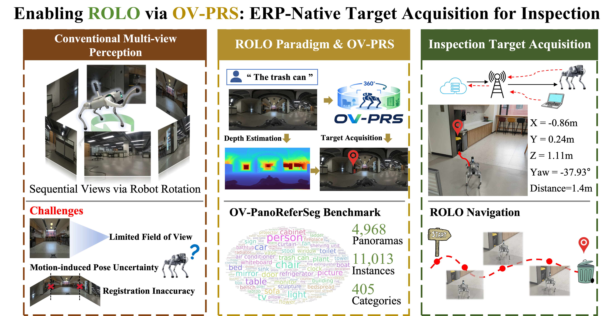

<div align="center">
  <h1>Robot Only Look Once: Advancing ERP-Native Open-Vocabulary Panoramic Referring Segmentation for Embodied Target Acquisition and Inspection</h1>
  <p><strong>Yunxiao Yang<sup>1</sup>, Kai Luo<sup>2</sup>, Haoran Lin<sup>2</sup>, Di Wen<sup>3</sup>, Ruiping Liu<sup>3</sup>, Kunyu Peng<sup>3</sup>, Wenrui Chen<sup>2</sup>, and Kailun Yang<sup>1,2</sup></strong></p>
  <p>
    <sup>1</sup> College of Integrated Circuits, Hunan University, China<br>
    <sup>2</sup> School of Artificial Intelligence and Robotics and the National Engineering Research Center of Robot Visual Perception and Control Technology, Hunan University, China<br>
    <sup>3</sup> Institute for Anthropomatics and Robotics, Karlsruhe Institute of Technology, Germany
  </p>
  
</div>

**Release status.** The OV-PRS trained checkpoints and OV-PanoReferSeg dataset are pending release.

## Repository layout

| Path | Purpose |
| --- | --- |
| [`ov_prs/training/`](ov_prs/training/) | Proposal and alignment training, then ranker training |
| [`ov_prs/feature_cache/`](ov_prs/feature_cache/) | Precompute PanoWorld features |
| [`ov_prs/`](ov_prs/) | Inference, evaluation, and model setup |

## Install

Use Linux with an NVIDIA GPU. Run the commands from the repository root.

```bash
conda env create -f environment.yml
conda activate ov-prs
python -m pip install torch==2.7.0 torchvision==0.22.0 --index-url https://download.pytorch.org/whl/cu126
python -m pip install -r requirements.txt
```

Transformers downloads the initial Mask2Former and CLIP weights on first use. For PanoWorld-Hstar, follow the upstream setup and point to its checkout and downloaded checkpoint. [PanoWorld paper](https://arxiv.org/abs/2605.13169) · [PanoWorld setup](https://github.com/wcpcp/PanoWorld#environment-setup)

```bash
export PANOWORLD_REPO=/path/to/PanoWorld
export PANOWORLD_MODEL=/path/to/PanoWorld_Hstar
```

If the loader reports legacy tensor names, convert the Hstar checkpoint and update its path.

```bash
python -m ov_prs.prepare_panoworld_checkpoint "$PANOWORLD_MODEL" checkpoints/PanoWorld_Hstar_fixed
export PANOWORLD_MODEL="$PWD/checkpoints/PanoWorld_Hstar_fixed"
```

## Train and evaluate

Put the benchmark in `data/` or set `OVPRS_DATA_ROOT`. Repeat this layout for `base_train`, `base_test`, `novel_test`, and `ood`.

```text
data/<split>/annotations.csv
data/<split>/data/<category>/original/<unique_name>.jpg
data/<split>/data/<category>/mask/<unique_name>.png
```

The CSV has `unique_name`, `category`, `description`, and `target_word` columns.

```bash
python -m ov_prs.feature_cache.cash_panoworld
TRAIN_STAGE=0 python -m ov_prs.training.trainv1_stage1_2
TRAIN_STAGE=1 python -m ov_prs.training.trainv1_stage1_2
TRAIN_STAGE=2 python -m ov_prs.training.trainv1_stage1_2
python -m ov_prs.training.trainv1_stage3 --stage all
python -m ov_prs.evaluate --no_vis
```

Training writes checkpoints to `outputs/` by default. If using an existing OV-PRS checkpoint, pass its root to the evaluation command with `--checkpoint-dir`.

## Inference

Use the checkpoints produced by training or point `--checkpoint-dir` to your own OV-PRS checkpoint directory.

```bash
python -m ov_prs.inference_pipeline \
  --input /path/to/panorama.jpg \
  --query "the red fire extinguisher" \
  --checkpoint-dir outputs
```

For video input, use `--mode video` and pass an ERP video to `--input`.
